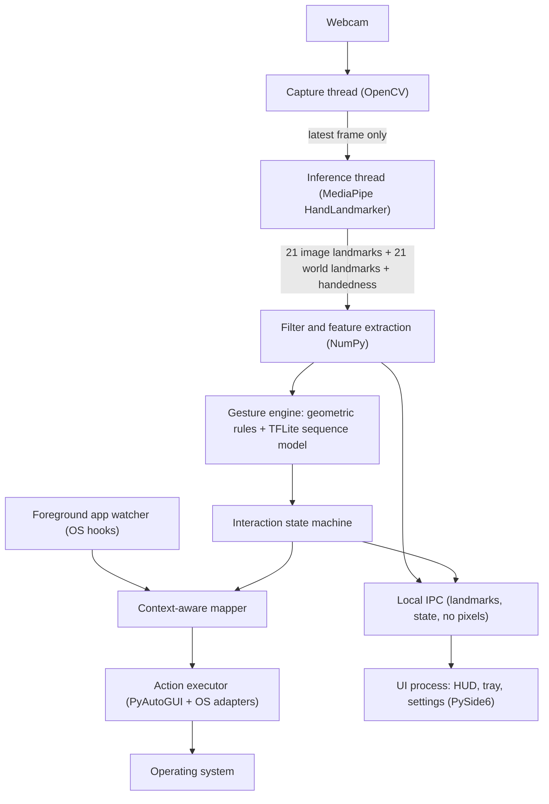
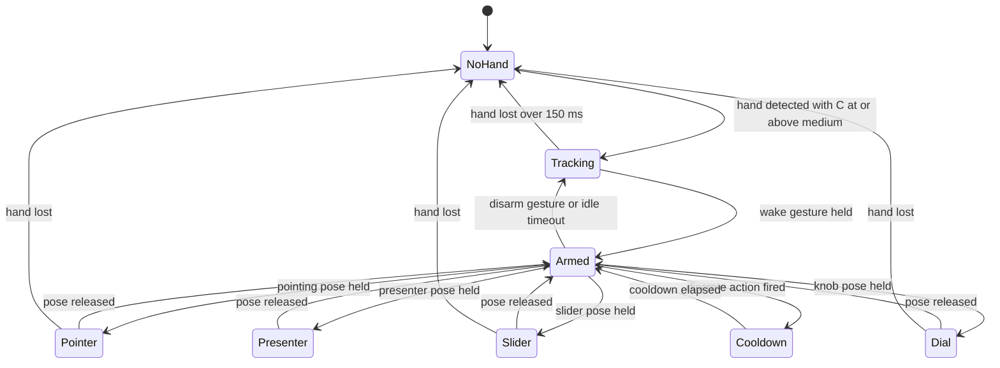
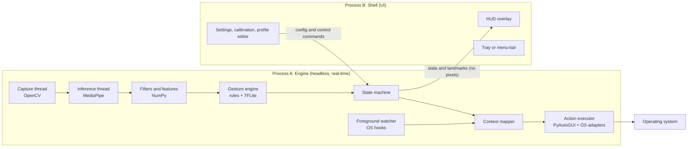

# Air Gesture Control — PRD, TRD & Technical Stack Architecture

**Product:** 100% offline, webcam-based air gesture control for laptops
**Scope of this document:** product definition (Part A), technical requirements (Part B), and stack architecture (Part C)
**Focus:** human-computer interaction only. Hand motion is mapped to OS commands; the system never interprets gestures as language.

---

## Contents

- **Part A — Product Requirements Document (PRD)**
- **Part B — Technical Requirements Document (TRD)**
- **Part C — Technical Stack Architecture**
- **Appendix — Default parameters, formulas, glossary**

---

# PART A — PRODUCT REQUIREMENTS DOCUMENT

## A1. Product Summary

Air Gesture Control (AGC) is a background desktop utility that uses the laptop's built-in webcam to track one hand, recognize deliberate gestures, and translate them into operating system actions: media control, window switching, scrolling, pointer control, volume/brightness adjustment, presentation navigation, and per-application shortcuts.

Everything happens on the device. No video frame, landmark, gesture, or setting ever leaves the machine, and the product functions with networking fully disabled.

**Vision:** hands-free control that feels instant, does not tire the user's arm, and can be trusted around a camera because it provably never talks to the network.

## A2. Problem Statement

1. Keyboards, trackpads, and mice force users to break posture or attention for small, frequent actions (pause a video, mute a call, flip a slide, switch windows).
2. Existing "gesture" products either depend on cloud processing (a privacy problem), require special hardware, or demand large mid-air arm movements that cause fatigue ("gorilla arm").
3. Naïve gesture systems fire on incidental hand motion (the "Midas touch" problem), which makes them unusable during ordinary work.

## A3. Goals and Non-Goals

### Goals

| ID | Goal |
|----|------|
| G1 | Perceptually instant response: continuous controls feel like direct manipulation, not command-and-wait. |
| G2 | Absolute privacy: fully offline, no persisted imagery, no telemetry, verifiable by the user. |
| G3 | Ergonomic by default: the primary interaction set is performed with the forearm resting on the desk. |
| G4 | Predictable: near-zero accidental activations through explicit arming, hysteresis, and visible state. |
| G5 | Context-aware: the same gesture does the right thing in each application. |
| G6 | Transparent: an on-screen HUD always shows what the system sees and what state it is in. |
| G7 | Works on stock laptop hardware with no GPU and no extra sensors. |

### Non-Goals

- Interpretation of hand shapes as language or symbols of any kind. Gestures are motions bound to commands.
- Full-body, face, gaze, or multi-person tracking.
- Cloud sync, accounts, online model updates, or analytics.
- Replacing keyboard or mouse for precision or text-entry tasks.
- Mobile or tablet platforms.

## A4. Target Users and Use Cases

| Persona | Situation | Key needs |
|---------|-----------|-----------|
| **Focused knowledge worker** | Typing-heavy work with music, calls, and many windows | Micro-gestures with hand resting; window switching; push-to-mute; no accidental triggers while typing |
| **Presenter / teacher** | Delivering slides from a laptop, standing or seated a short distance away | Reliable swipe clicker; simple on/off; large motions acceptable |
| **Creator / developer** | Figma, VS Code, browser dev workflows | Per-app bindings; canvas panning; terminal toggle; pinch-drag |
| **Users with limited fine-motor or reach capability** | Trackpad or mouse use is difficult or painful | Air mouse; adjustable thresholds; low-effort micro-gestures |
| **Privacy-sensitive professional** | Regulated or air-gapped environment | Provable offline operation; no stored imagery |

**Representative scenarios**

1. Watching a tutorial while typing notes: pause with a thumb-to-index tap without moving the arm.
2. In a video call: hold a gesture to mute while a colleague speaks, release to unmute.
3. Presenting: swipe right to advance slides from two meters away.
4. Adjusting volume smoothly by twisting an imaginary knob.
5. Working in Figma: hold a pinch and move the hand to pan the canvas.

## A5. Product Principles

1. **Deliberate over clever.** Nothing fires unless the user has armed the system or is in an explicitly entered mode.
2. **Small motions win.** Every high-frequency action has a micro-gesture form that fits a resting forearm.
3. **Visible state.** The user can always see whether the system is watching, armed, or acting.
4. **Reversible and safe.** Destructive OS actions are never bound by default; every held key or button is released when a gesture, mode, or profile ends.
5. **Local means local.** Privacy claims are backed by architecture, not policy.

## A6. Feature Scope and Priority

Priority: **P0** = required for the product to be viable, **P1** = required for the full product experience, **P2** = enhancement.

| ID | Feature | Priority |
|----|---------|----------|
| F1 | Core macros: media play/pause, next/previous, window switching | P0 |
| F2 | Wake/arm mechanism, disarm, privacy pause, panic kill switch | P0 |
| F3 | On-screen HUD (state, confidence, gesture progress, continuous gauges) | P0 |
| F4 | Micro-gestures (thumb-index tap, two-finger scroll, wrist tilt) | P0 |
| F5 | First-run calibration and camera/lighting check | P0 |
| F6 | Context-aware mapping with per-application profiles | P1 |
| F7 | Continuous rate-control (virtual dial) for volume/scrub | P1 |
| F8 | Analog volume/brightness sliders (index-to-thumb distance) | P1 |
| F9 | Air mouse (absolute index fingertip) | P1 |
| F10 | Click-to-drag via pinch | P1 |
| F11 | Presentation clicker mode (left/right swipes) | P1 |
| F12 | Profile editor (view, rebind, import/export profiles) | P1 |
| F13 | Per-user gesture personalization (recorded templates) | P2 |
| F14 | Two-hand support (second hand as modifier) | P2 |
| F15 | Relative/clutch pointer mode with precision gain | P2 |

## A7. User Experience Requirements

### A7.1 First-run experience

1. Permission explanations (camera; on macOS also Accessibility for input injection), shown before any OS prompt.
2. **Camera and framing check:** live preview confirms the hand is visible in the "resting zone" (see B3.6), warns on low light, backlight, and camera obstruction.
3. **Dominant hand selection** and neutral-pose capture (relaxed hand resting on desk).
4. **Calibration:** open palm, fist, pinch open/closed, index-thumb span, and a small wrist roll and tilt. These produce per-user thresholds.
5. **Guided tutorial:** one action at a time with live HUD feedback and a success indicator.
6. Explicit statement of the offline guarantee, with a link to the in-app "Privacy Proof" panel (B12).

### A7.2 Everyday interaction model

1. **Unarmed (default):** the camera runs at a low duty cycle. Nothing can trigger except the wake gesture.
2. **Wake:** hold an open palm for 500 ms (or perform a double thumb-index tap from the resting pose). HUD confirms "Armed".
3. **Armed:** gestures and modes are live. Auto-disarm after 8 seconds of inactivity (configurable) or on the disarm gesture.
4. **Modes** (pointer, slider, dial, presenter) are entered by a specific pose and exited by relaxing the pose, moving the hand out of frame, or pressing the panic hotkey.

### A7.3 Controls outside gestures

- **Tray/menu-bar icon** with states: Paused, Watching (unarmed), Armed, Error.
- **Global hotkey:** pause/resume tracking (releases the camera so its indicator light goes off).
- **Panic hotkey:** instantly disarms, releases all held inputs, and pauses tracking.
- **Settings window:** sensitivity, thresholds, HUD style, per-app profiles, calibration re-run, diagnostics.

### A7.4 HUD (product view)

A transparent, click-through overlay that shows:

- Current state (No hand / Tracking / Armed / active mode name)
- Tracking confidence meter with three color bands
- Gesture recognition progress ring while a dwell gesture is being held
- Live gauge for continuous controls (dial, sliders) including anchor and dead-zone markers
- Brief action toast ("Play / Pause", "Muted") that fades
- Warnings (low light, hand near frame edge, camera busy)
- Active profile name whenever the foreground application changes

HUD styles: **Off**, **Minimal** (state chip only), **Standard** (default), **Debug** (skeleton, FPS, per-stage latency).

### A7.5 Accessibility

- Left- or right-hand use, adjustable dwell times, thresholds, and dead zones.
- High-contrast and color-blind-safe HUD palette; reduced-motion option.
- Every gesture-bound action also reachable via configurable alternatives (e.g., a different gesture).

## A8. Success Metrics (Product-Level Targets)

| Metric | Target |
|--------|--------|
| Motion-to-effect latency (continuous controls), p95 | ≤ 100 ms end-to-end with a typical 30 fps webcam |
| Software-controlled portion of that latency, p95 | ≤ 30 ms |
| Recognition, deliberate discrete gestures (recall) | ≥ 95% after calibration |
| Static pose classification F1 | ≥ 0.97 |
| Unintended actions while **armed**, during normal work (typing, mouse, talking with hands visible) | ≤ 1 per 2 hours |
| Unintended actions while **unarmed** | 0 by design |
| CPU, armed and tracking, on a 4-core laptop-class CPU | ≤ 25% of total CPU |
| CPU, unarmed, hand absent | ≤ 8% of total CPU |
| Memory | ≤ 500 MB resident |
| Network connections opened by the app | 0 |

## A9. Product Assumptions, Dependencies, and Risks

| Risk / Constraint | Impact | Mitigation in the product |
|-------------------|--------|---------------------------|
| **Resting hand may fall outside the webcam's field of view.** Laptop webcams look up at the user; a hand resting on the desk near the keyboard can be out of frame or at the frame edge. | Micro-gestures unavailable | Calibration "resting zone" check; setup guidance (screen tilt, hand placement); ROI guide on HUD; support for external webcam |
| **Camera sharing with video-call apps** is device- and OS-dependent. | Tracking cannot start during calls on some machines | Detect "camera busy" and show a clear HUD message; prefer OS frame-sharing APIs where available; support alternate camera |
| **Low light, backlighting, cluttered skin-toned backgrounds** | Lower confidence | Confidence gating; light-quality warning; auto exposure hints |
| **Accidental activation** | Loss of trust | Arming, dwell, hysteresis, cooldowns, no destructive defaults |
| **Wayland and OS security models** restrict global input injection and foreground-app detection. | Reduced Linux support | Tiered platform support (B14) |
| **App shortcuts vary** (mute shortcut differs per call app and version). | Wrong action | Editable profiles; shipped defaults documented; push-to-talk mode where an app supports it |
| **Monocular depth is relative.** | No absolute distance-based gestures | Gestures are designed around 2D motion, hand-scale-normalized geometry, and relative angles |

---

# PART B — TECHNICAL REQUIREMENTS DOCUMENT

Requirement language: **shall** = mandatory, **should** = strongly recommended, **may** = optional. Requirement IDs are stable references.

## B1. System Context and Constraints

| ID | Constraint |
|----|------------|
| SYS-1 | The system shall run entirely on the local machine with no network dependency at install, first run, or runtime. |
| SYS-2 | The system shall run on CPU only; GPU acceleration may be optional. |
| SYS-3 | Input shall be a single standard RGB webcam, 640×480 or higher, 30 fps or higher. |
| SYS-4 | The system shall track one hand by default (`num_hands = 1`); two-hand tracking is P2. |
| SYS-5 | The system shall operate in a background process with a separate UI process (B10.2). |
| SYS-6 | All model files shall ship inside the installer; no runtime downloads. |

**"Zero-latency" definition.** Physical zero is impossible: camera exposure, sensor readout, USB transport, and display refresh contribute roughly 40–80 ms outside the software's control. The requirement is therefore *perceptual immediacy*: the software-controlled portion shall be ≤ 30 ms p95, and end-to-end ≤ 100 ms p95 on reference hardware.

## B2. End-to-End Data Flow



Each frame carries a monotonic capture timestamp through every stage so that per-stage latency can be measured and shown in Debug HUD mode.

## B3. Vision Pipeline

### B3.1 Capture (OpenCV)

| ID | Requirement |
|----|-------------|
| VIS-1 | Capture shall run on a dedicated thread that stores only the **most recent frame** (buffer depth 1); stale frames are dropped, never queued. |
| VIS-2 | The capture backend shall be the native one per OS (DirectShow or Media Foundation on Windows, AVFoundation on macOS, V4L2 on Linux). |
| VIS-3 | Requested format: 640×480 (or 640×360), 30 fps, MJPG where supported (reduces USB bandwidth and decode wait); `CAP_PROP_BUFFERSIZE = 1` where supported. |
| VIS-4 | Frames shall be horizontally mirrored before inference so that screen-space direction matches the user's intuition. |
| VIS-5 | Frames shall never be written to disk, logged, or passed to another process. |
| VIS-6 | The system shall enumerate cameras, remember the chosen device, and handle hot-unplug and "device busy" without crashing. |

### B3.2 Landmark extraction (MediaPipe)

| ID | Requirement |
|----|-------------|
| VIS-7 | Use the MediaPipe **Tasks** `HandLandmarker` (the legacy `solutions.hands` API is deprecated), model bundled locally. |
| VIS-8 | Running mode `VIDEO` with strictly increasing millisecond timestamps, so that detection is followed by lightweight tracking between frames. |
| VIS-9 | Initial confidence settings: `min_hand_detection_confidence = 0.6`, `min_hand_presence_confidence = 0.5`, `min_tracking_confidence = 0.5`; exposed as advanced settings. |
| VIS-10 | Consume both outputs: **image landmarks** (normalized x, y in frame, for screen position) and **world landmarks** (metric, hand-centered, for angles and scale-invariant geometry). |

Landmark index reference (used throughout): 0 wrist; 1–4 thumb (CMC, MCP, IP, TIP); 5–8 index (MCP, PIP, DIP, TIP); 9–12 middle; 13–16 ring; 17–20 pinky.

### B3.3 Filtering and stabilization (NumPy)

| ID | Requirement |
|----|-------------|
| VIS-11 | Each landmark coordinate shall pass through a **One Euro filter** (speed-adaptive low-pass): heavy smoothing when slow, minimal lag when fast. Initial parameters `min_cutoff = 1.2`, `beta = 0.05`, `d_cutoff = 1.0`, tuned per feature. |
| VIS-12 | Filters shall be time-aware (use actual frame timestamps, not assumed FPS). |
| VIS-13 | On hand loss for < 150 ms, state shall be held (coasting); beyond that, tracking resets and all held inputs are released. |

### B3.4 Feature extraction

Computed each frame from filtered landmarks:

| Feature | Definition |
|---------|------------|
| Hand scale `s` | `‖L0 − L9‖` in world coordinates (wrist to middle MCP) |
| Normalized landmarks | Wrist-relative, divided by `s`, rotated into the palm frame |
| Pinch ratio | `‖L4 − L8‖ / s` (thumb tip to index tip) |
| Finger extension | Per-finger flexion angle at PIP/MCP joints; extended if angle > ~160° |
| Palm normal `n` | `normalize((L5 − L0) × (L17 − L0))`, sign-corrected by handedness |
| Forearm axis proxy | Unit vector `L0 → L9` |
| Velocity | Finite difference of palm centroid and fingertips, in `s` units per second |
| Roll angle | Angle of `n` about the forearm axis proxy, relative to the anchored neutral |
| Tilt angle | Lateral (radial/ulnar) deviation of `L0 → L9` in-plane relative to calibrated neutral; flexion/extension from world-space pitch |

### B3.5 Tracking confidence (for HUD and action gating)

MediaPipe's Python result exposes handedness scores but not a rich per-frame quality metric, so AGC computes a composite:

```
C = w1 * handedness_score
  + w2 * bone_length_consistency      (bone lengths vs. running per-user baseline)
  + w3 * temporal_stability           (1 − normalized landmark jitter)
  + w4 * frame_margin_score           (penalty when hand is clipped by frame edges)
```

Initial weights: 0.35 / 0.30 / 0.20 / 0.15. Bone-length consistency is a strong indicator of a bad fit, since real bone lengths do not change between frames.

| Band | Range | System behavior |
|------|-------|-----------------|
| High | C ≥ 0.75 | All actions permitted |
| Medium | 0.55 ≤ C < 0.75 | Continuous controls permitted with HUD warning; discrete actions suppressed |
| Low | C < 0.55 | Actions suppressed; held inputs released after 150 ms |

Band transitions use hysteresis (±0.05) to prevent flicker.

### B3.6 Spatial zones

- **Pointer ROI:** a configurable rectangle within the frame (default: central 60% width × 60% height) mapped to the screen for air mouse.
- **Resting zone:** the region where a desk-resting hand appears; validated during calibration and drawn on the HUD in Debug mode.

## B4. Interaction Model and State Machine

Preventing accidental activation is the core interaction design problem. All actions pass through an explicit state machine.



| ID | Requirement |
|----|-------------|
| FSM-1 | Discrete actions fire only in `Armed` (or in a mode that explicitly declares them, e.g., pinch in `Pointer`). |
| FSM-2 | A pose becomes "held" only after a **dwell** (default 250 ms for mode entry, 500 ms for wake and toggles) with the confidence band High. |
| FSM-3 | Every pose uses **hysteresis** (separate enter/exit thresholds) and a **debounce** window (default 3 consecutive frames). |
| FSM-4 | After a discrete action, a **cooldown** (default 400 ms; 600 ms for swipes) blocks repeats. |
| FSM-5 | On every exit from a mode, hand loss, profile switch, panic, or pause: all held keys and mouse buttons shall be released. |
| FSM-6 | State transitions shall be emitted to the UI process within one frame for HUD display. |
| FSM-7 | Arming timeout default 8 s of no recognized gesture or mode activity; configurable, or "never" for presenters. |

## B5. Gesture Vocabulary

Gesture detection is layered: **geometric rules** for static poses and micro-gestures (deterministic, calibratable, sub-millisecond), and a **TFLite sequence model** for dynamic gestures (swipes, flicks) where timing and trajectory matter (B11). Detectors emit *gesture events*; the mapper (B7) decides what each event does in the current context.

| Gesture ID | Type | Detection summary |
|------------|------|-------------------|
| `OPEN_PALM_HOLD` | Static | All five fingers extended, held 500 ms. Wake gesture; extended hold (1.5 s) = disarm. |
| `FIST_HOLD` | Static | All fingers flexed, held 500 ms. |
| `POINT_POSE` | Static | Index extended; middle, ring, pinky flexed. Enters Pointer. |
| `SLIDER_POSE` | Static | Thumb and index extended, others flexed. Enters Slider (volume). Middle also extended: brightness. |
| `KNOB_POSE` | Static | Thumb, index, and middle tips gathered (as if gripping a knob). Enters Dial. |
| `PEACE_HOLD` | Static | Index and middle extended, others flexed; held 250 ms. Enters window-switcher hold. |
| `PRESENT_POSE` | Static | Open palm facing camera, held 300 ms. Arms the swipe in Presenter mode. |
| `SWIPE_L` / `SWIPE_R` | Dynamic | Open palm lateral sweep (B10.4 and B11). |
| `FLICK_L` / `FLICK_R` | Dynamic | Two-finger quick lateral flick. |
| `TAP` | Micro | Thumb-to-index contact and release within 300 ms, resting pose. |
| `DOUBLE_TAP` | Micro | Two `TAP`s within 600 ms. |
| `LONG_PINCH` | Micro | Thumb-index contact held ≥ 600 ms (press/release events both emitted). |
| `SCROLL_2F` | Micro | Index+middle extended, small vertical fingertip motion → signed scroll delta. |
| `TILT_L` / `TILT_R` | Micro | Lateral wrist tilt beyond threshold from neutral, then return. |
| `TILT_U` / `TILT_D` | Micro | Wrist flexion/extension beyond threshold (P2 because monocular pitch is noisier). |
| `PINCH_DOWN` / `PINCH_UP` | Mode | Thumb-index contact/release inside Pointer mode. |

All numeric thresholds are initial defaults (see Appendix) and are scaled by per-user calibration.

## B6. Feature: Core Macros

### B6.1 Media control

| ID | Requirement |
|----|-------------|
| MAC-1 | `FIST_HOLD` (Armed) shall trigger **Play/Pause** by default. |
| MAC-2 | `SWIPE_R` / `SWIPE_L` shall trigger **Next / Previous track** by default (overridden in the Presenter profile). |
| MAC-3 | Media actions shall use the OS media-key path, so they control whichever player currently owns media focus (browser tab, Spotify, VLC, etc.) even when not in the foreground. |
| MAC-4 | Fallback when no media session exists: profile-defined key (e.g., `space` in a focused player). |

### B6.2 System window switching

| ID | Requirement |
|----|-------------|
| MAC-5 | `FLICK_R` / `FLICK_L` shall trigger next/previous window (`Alt+Tab` / `Alt+Shift+Tab` on Windows and Linux; `Cmd+Tab` / `Cmd+Shift+Tab` on macOS). |
| MAC-6 | **Switcher-hold mode:** entering `PEACE_HOLD` presses and holds the platform modifier (Alt/Cmd); each `FLICK` sends `Tab` / `Shift+Tab` to move selection; leaving the pose releases the modifier, which commits the choice. |
| MAC-7 | If the hand is lost or confidence drops while the modifier is held, the modifier shall be released within 150 ms (FSM-5). |
| MAC-8 | Task View / Mission Control shortcut may be bound to a profile action; no window-closing or quitting action shall be bound by default. |

## B7. Feature: Context-Aware Mapping

### B7.1 Foreground application detection (OS hooks)

| OS | Mechanism | Notes |
|----|-----------|-------|
| **Windows** | `SetWinEventHook(EVENT_SYSTEM_FOREGROUND)` on a dedicated message-loop thread; resolve PID with `GetWindowThreadProcessId`, executable path with `QueryFullProcessImageName` (or `psutil`); title via `GetWindowText` | UWP apps are hosted by `ApplicationFrameHost.exe`; resolve the child window's real process. Set the process DPI-aware so coordinates match. |
| **macOS** | `NSWorkspace` `didActivateApplicationNotification` observer (PyObjC); bundle identifier from `frontmostApplication` | Window titles require the Accessibility permission (already needed for input injection). |
| **Linux X11** | `_NET_ACTIVE_WINDOW` property change events (python-xlib / EWMH) | `WM_CLASS` and `_NET_WM_NAME` for matching. |
| **Linux Wayland** | No standard API; compositor-specific (GNOME extension/D-Bus, KWin scripting, wlroots foreign-toplevel) | Best-effort tier (B14). |

| ID | Requirement |
|----|-------------|
| CTX-1 | Prefer event-driven foreground detection; fall back to 100–200 ms polling where events are unavailable. |
| CTX-2 | Switching debounce: 150 ms, to avoid flapping during Alt+Tab. |
| CTX-3 | On every profile switch: release held inputs, update HUD with the new profile name, and reset dwell timers. |
| CTX-4 | Foreground detection shall read only application identity and window title; no window contents. |

### B7.2 Profile model and resolution

Resolution order (first match wins): (1) application + title regex, (2) application identifier, (3) application category, (4) `global`. A profile may `inherit` another and override individual bindings.

```yaml
schema_version: 1
profiles:
  - id: global
    match: { default: true }
    bindings:
      - { gesture: FIST_HOLD,  action: { type: media, op: play_pause } }
      - { gesture: SWIPE_R,    action: { type: media, op: next_track } }
      - { gesture: FLICK_R,    action: { type: hotkey, keys: [alt, tab] } }
      - { gesture: TAP,        action: { type: media, op: play_pause } }

  - id: vscode
    inherit: global
    match:
      process: ["Code.exe", "Code", "com.microsoft.VSCode"]
    bindings:
      - { gesture: DOUBLE_TAP, action: { type: hotkey, keys: [ctrl, "`"] } }   # toggle integrated terminal

  - id: calls
    inherit: global
    match:
      process: ["Zoom.exe", "Teams.exe", "zoom.us", "chrome.exe", "msedge.exe", "firefox.exe"]
      title_regex: "Meet|Zoom|Teams|Call"
    bindings:
      - gesture: LONG_PINCH                   # hold to mute, release to unmute
        action:
          type: momentary_toggle
          keys: [ctrl, d]                     # editable per app/OS
          on: [press, release]

  - id: figma
    inherit: global
    match: { process: ["Figma.exe", "Figma"] }
    bindings:
      - gesture: PINCH_DOWN                   # hold Space + drag = pan canvas
        action: { type: hold_key_and_drag, key: space, button: left }

  - id: presenter
    match: { process: ["POWERPNT.EXE", "Keynote", "AcroRd32.exe"] }
    presenter_mode: true
    bindings:
      - { gesture: SWIPE_R, action: { type: hotkey, keys: [right] } }
      - { gesture: SWIPE_L, action: { type: hotkey, keys: [left] } }
```

| ID | Requirement |
|----|-------------|
| CTX-5 | Action types shall include: `media`, `hotkey`, `key_hold`, `momentary_toggle`, `hold_key_and_drag`, `scroll`, `pointer`, `slider`, `rate_key`, `shell_command` (disabled by default; requires explicit user opt-in). |
| CTX-6 | Profiles are validated against a schema on load; invalid profiles are rejected with a specific error and the previous valid profile remains active. |
| CTX-7 | Profiles are plain, user-editable files in the user config directory; import/export is a file copy. |
| CTX-8 | The mapper shall be pure: `(gesture_event, profile) → action`. It has no knowledge of the camera or OS. |

### B7.3 Default context behaviors

| Context | Behavior |
|---------|----------|
| **VS Code** | `DOUBLE_TAP` toggles the integrated terminal (`Ctrl+\``); `TILT_L/R` switches editor tabs (`Ctrl+PageUp/PageDown`); `SCROLL_2F` scrolls the editor. |
| **Browser / call apps** | `LONG_PINCH` is **push-to-mute** (see below); `TILT_L/R` = back/forward (`Alt+←/→`); `SCROLL_2F` scrolls the page. |
| **Figma** | `PINCH_DOWN`/`PINCH_UP` = hold `Space` + primary button drag, panning the canvas with hand motion; `SCROLL_2F` = wheel scroll. |
| **Media players** | `TAP` play/pause; `KNOB_POSE` = scrub via rate control. |
| **Presentation apps** | Presenter mode auto-enabled (B10.4). |

**Push-to-mute semantics.** Two implementations, selectable per profile:

1. **Momentary toggle:** send the app's mute-toggle shortcut on `press`, send it again on `release`. Limitation: the app's mute state cannot be read, so if the user was already muted the behavior inverts. The HUD toast makes this visible and the profile can be switched to option 2.
2. **Push-to-talk:** hold the application's push-to-talk key (e.g., `Space` in apps that support it) while the gesture is held.

Application shortcuts differ by app, platform, and version, and most work only while the app or tab is foreground; defaults are documented and user-editable.

## B8. Feature: Micro-Gestures

Micro-gestures are designed for the **forearm resting on the desk** with the wrist as the pivot. Only finger and wrist motions are used.

### B8.1 Design principles

- Detection operates on wrist-relative, scale-normalized coordinates, so the absolute hand position in frame does not matter.
- Motion amplitudes are small: pinch travel of a few centimeters, wrist tilts of ~10–20°, fingertip scroll travel of ~1–2 cm equivalent (expressed in `s` units).
- Micro-gestures require `Armed`, and the arming timeout is extended while the hand stays in the resting pose.

### B8.2 Specifications

**Thumb-to-index tap (`TAP`, `DOUBLE_TAP`, `LONG_PINCH`)**

```
pinch_ratio = ||L4 − L8|| / s
pinch_on   when pinch_ratio < T_on   (default 0.25) for ≥ 2 consecutive frames
pinch_off  when pinch_ratio > T_off  (default 0.40)
TAP        = pinch_on → pinch_off within 300 ms, with palm-centroid travel < 0.15·s
DOUBLE_TAP = two TAPs, gap ≤ 600 ms
LONG_PINCH = pinch held ≥ 600 ms; emits PRESS at 600 ms and RELEASE at pinch_off
```

The hysteresis gap (0.25 vs 0.40) prevents chatter around the threshold. `T_on`/`T_off` are scaled by per-user calibration.

**Subtle two-finger scroll (`SCROLL_2F`)**

```
active   when index and middle are extended, ring and pinky flexed, thumb relaxed
signal   = vertical velocity of mean(L8, L12) in palm frame, in s/second
delta    = sign * gain * max(0, |signal| − dead_zone)^1.3
output   = scroll wheel ticks, accumulated and emitted at ≤ 60 Hz
```

Direction convention (fingers moving toward the screen = scroll down) is user-configurable. Motion is ignored while the wrist itself moves more than the fingers (guards against arm movement being read as scroll).

**Wrist tilt (`TILT_L/R`, P2: `TILT_U/D`)**

```
neutral       = median of forearm-axis angle over the calibration rest window
tilt          = angle(L0→L9) − neutral      (radial/ulnar deviation, in-plane)
event         = |tilt| > 12° held ≥ 100 ms, then return within ±5° of neutral
```

The event fires **on return** to neutral (a "flick") to avoid triggering during natural drift, and the tilt gesture is suppressed while other gestures are in progress. Alternatively, in a profile it may drive rate control (B9) for continuous panning or scrolling proportional to tilt.

| ID | Requirement |
|----|-------------|
| MIC-1 | Micro-gestures shall be detectable with the hand in the calibrated resting zone at CONFIDENCE band High. |
| MIC-2 | Micro-gesture thresholds shall auto-scale by hand scale `s` and per-user calibration. |
| MIC-3 | Micro-gestures shall not cause OS-level side effects when the hand is used for typing (Unarmed state blocks them). |
| MIC-4 | Two micro-gestures must never share the same finger configuration in the same mode; the mode layer disambiguates (e.g., pinch in Pointer mode = click; pinch outside Pointer = `TAP`). |

## B9. Feature: Continuous Controls (Rate Control) and Visual HUD

### B9.1 Virtual dial (twist)

The user forms `KNOB_POSE` and twists the forearm slightly (pronation/supination) about the forearm axis. The twist angle relative to an **anchor** captured at mode entry drives a **rate**, not a position.

```
anchor      = palm normal n₀ captured when KNOB_POSE is confirmed
Δθ          = signed angle between n and n₀ about the forearm-axis proxy
Δθ_eff      = sign(Δθ) * max(0, |Δθ| − θ_dead)         (θ_dead default 6°)
rate        = clamp( k * |Δθ_eff|^γ , 0, rate_max ) * sign(Δθ_eff)   (γ default 1.4)
value(t+dt) = value(t) + rate * dt
```

Properties: no jump at entry (relative anchoring), a dead zone to absorb tremor, a nonlinear curve for fine control near center and speed at extremes, symmetric exit (releasing the pose freezes the value).

**Output modes**

| Mode | Behavior | Typical use |
|------|----------|-------------|
| **Rate → value** | Integrate rate into an OS value (volume, brightness) via native setters | Smooth volume |
| **Rate → key repeat** | Map rate to key-repeat frequency (e.g., `→`/`←`, `J`/`L`, `Shift+→`), from 0 to ~10 Hz | Scrubbing video/audio in apps without a scrub API |
| **Detent** | Emit one tick per `N°` of twist | Discrete steps (volume ±2%) |

Rate-key mappings are per-profile because scrubbing shortcuts differ by app.

### B9.2 HUD technical requirements

| ID | Requirement |
|----|-------------|
| HUD-1 | The HUD is a frameless, transparent, always-on-top, **click-through and non-activating** window; it shall never take focus or intercept input. |
| HUD-2 | It shall render at the display refresh rate (typically 60 Hz) independent of the vision rate, interpolating between the ~30 Hz state updates. |
| HUD-3 | It shall show: state chip, confidence meter (color band + numeric in Debug), dwell progress ring, continuous gauge with anchor and dead-zone marks, action toast (≈600 ms fade), warnings, active profile name. |
| HUD-4 | It shall receive only landmarks and state over IPC — never pixels. Optional skeleton is drawn from landmarks. |
| HUD-5 | It shall follow the active monitor, auto-hide after idle (default 2 s in Minimal/Standard), and reappear on state change. |
| HUD-6 | Styles Off / Minimal / Standard / Debug; Debug adds FPS, per-stage timings (capture, inference, filter, classify, actuate), and the confidence sub-scores. |
| HUD-7 | High-contrast, color-blind-safe palette; reduced-motion option; scalable size. |
| HUD-8 | Platform behaviors: Qt flags `FramelessWindowHint`, `WindowStaysOnTopHint`, `Tool`, `WindowTransparentForInput`, `WA_TranslucentBackground`, `WA_ShowWithoutActivating`; on macOS the window's collection behavior must include join-all-Spaces and full-screen-auxiliary (via PyObjC) to appear over full-screen apps. Exclusive full-screen applications may cover overlays; borderless full-screen is supported. |

## B10. Value-Add Features (Raw Coordinate Extraction)

These features reuse the same landmark pipeline and require little additional logic.

### B10.1 Analog volume and brightness sliders (index-to-thumb distance)

```
d   = ||L4 − L8|| / s                                 (normalized thumb–index span)
u   = clamp( (d − d_min) / (d_max − d_min), 0, 1 )    (d_min/d_max from calibration)
u'  = EMA(u, α = 0.35) with dead-band ±0.02
```

| ID | Requirement |
|----|-------------|
| SLD-1 | `SLIDER_POSE` (held 250 ms) enters Slider mode for **volume**; with the middle finger also extended, **brightness**. |
| SLD-2 | **Anchored mapping:** at entry, the current system value `V₀` is read; output `V = V₀ + (u' − u₀) · gain` (clamped 0–1), so there is no jump when the mode starts. An "absolute" mapping option is available. |
| SLD-3 | Volume via native APIs (Windows Core Audio through `pycaw`; macOS `osascript`/CoreAudio; Linux `pactl`/`wpctl`). Brightness via `screen_brightness_control` (Windows/Linux) or the macOS equivalent. `PyAutoGUI` key presses are only a stepwise fallback. |
| SLD-4 | Value updates are rate-limited to ≤ 30 Hz and coalesced. |
| SLD-5 | HUD gauge shows the live value, min/max span, and the entry anchor. |
| SLD-6 | **Acceptance:** thumb–index span sweep from closed to fully open changes the value across the full range with no visible stepping; releasing the pose holds the value. |

### B10.2 Basic air mouse (absolute index fingertip)

```
(x, y)   = filtered L8 in image space, mirrored
u = (x − roi.x0) / roi.w ;  v = (y − roi.y0) / roi.h ;  clamp to [0,1]
cursor   = (monitor.x + u · monitor.w,  monitor.y + v · monitor.h)
```

| ID | Requirement |
|----|-------------|
| PTR-1 | `POINT_POSE` (held 250 ms) enters Pointer mode; cursor tracks the index fingertip until the pose is released. |
| PTR-2 | Absolute mapping from the pointer ROI to the **active monitor**; ROI size and position are configurable; multi-monitor supported by monitor selection or by mapping the ROI across the virtual desktop. |
| PTR-3 | One Euro filter tuned for the pointer (stronger smoothing at low speed), plus a 2–3 px rest dead zone. |
| PTR-4 | Pointer updates ≤ 60 Hz using direct move calls with zero PyAutoGUI delay (see B11.1). |
| PTR-5 | If Pointer mode is left, the cursor stays where it is; no return or jump. |
| PTR-6 | P2: relative **clutch** mode with speed-dependent gain for precision; needs a clutch pose to reposition the hand. |
| PTR-7 | **Acceptance:** the fingertip reaches any screen corner within the ROI, and the cursor is stable (< 3 px drift) when the hand is held still for 2 s. |

### B10.3 Click-to-drag via pinch

```
In Pointer mode:
  PINCH_DOWN when pinch_ratio < T_on   → latch position P0 = cursor position at (t − 120 ms)
  mouseDown at P0
  while pinched → cursor follows the fingertip (drag)
  PINCH_UP   when pinch_ratio > T_off → mouseUp
  CLICK       if press duration < 300 ms and travel < 12 px
  DOUBLE-CLICK if two CLICKs within 350 ms
```

**Pre-pinch position latch:** closing the thumb and index shifts the fingertip landmark and would drag the cursor off its target at the moment of the click. Using the cursor position from ~120 ms before pinch onset (kept in a ring buffer), and holding the cursor still during pinch onset (~80 ms), makes clicks land where the user aimed.

| ID | Requirement |
|----|-------------|
| DRG-1 | `PINCH_DOWN` issues mouse-down; `PINCH_UP` issues mouse-up; dragging is continuous pointer motion between them. |
| DRG-2 | The mouse button shall be released on hand loss, low confidence, pose exit, panic, pause, or profile switch (FSM-5). |
| DRG-3 | Thumb–middle pinch = secondary click (P2). |
| DRG-4 | Profiles may remap `PINCH_DOWN/UP` (e.g., Figma canvas pan = hold `Space` + drag, B7.3). |
| DRG-5 | **Acceptance:** 20 consecutive clicks on a 24×24 px target succeed at ≥ 90% after calibration. |

### B10.4 Presentation clicker (left/right swipes)

```
Swipe detection on the palm centroid (mean of L0, L5, L9, L13, L17), mirrored:
  displacement Δx ≥ 0.25 (normalized frame width) within a window ≤ 250 ms
  peak speed ≥ 1.2 frame-widths/s
  direction dominance: |Δx| ≥ 2.5 · |Δy|
  requires open palm (≥ 4 extended fingers) during the swipe
  refractory period 600 ms after any swipe
```

| ID | Requirement |
|----|-------------|
| PRS-1 | In a profile with `presenter_mode: true` (or when toggled manually), `SWIPE_R` sends the "next" key and `SWIPE_L` sends "previous" (`→`/`←` by default; `PageDown`/`PageUp` for PDF viewers). |
| PRS-2 | Two sensitivity styles: **Fluid** (open-palm swipe fires directly) and **Strict** (hold `PRESENT_POSE` 300 ms, then swipe within 1.5 s) to prevent triggers while the presenter gestures naturally while talking. |
| PRS-3 | Optional bindings: `FIST_HOLD` → start slideshow / black screen; `OPEN_PALM_HOLD` (1.5 s) → disarm. |
| PRS-4 | The arming timeout is disabled in Presenter mode; the HUD state chip reads "Presenting". |
| PRS-5 | Both swipe directions are equally reliable for left- and right-handed users. |
| PRS-6 | **Acceptance:** ≥ 95% of deliberate swipes recognized at 1–2 m distance; ≤ 1 false swipe per 10 minutes of normal speaking gestures in Strict style. |

## B11. Learned Models (TFLite / PyTorch)

Rules handle poses and micro-gestures. A small learned model handles **dynamic gestures** (swipes, flicks) and improves rejection of incidental motion.

| Aspect | Specification |
|--------|---------------|
| **Task** | Classify a sliding window of hand motion into `NONE`, `SWIPE_L`, `SWIPE_R`, `FLICK_L`, `FLICK_R`, plus a "non-gesture motion" class for hard negatives (reaching for a mug, scratching, typing). |
| **Input** | Window of T = 16–24 frames (≈ 0.5–0.8 s); per frame 63 normalized wrist-relative coordinates + 63 velocity features = 126 dims. Window advances every frame. |
| **Architecture** | Small temporal CNN or GRU (≤ ~200k parameters), int8-quantized. |
| **Runtime** | TFLite / LiteRT interpreter on CPU with XNNPACK; **≤ 2 ms per inference**. |
| **Training** | Offline in **PyTorch** (or Keras); exported to TFLite (via ONNX or the vendor converter). **PyTorch is a development-time dependency only; it is not shipped.** |
| **Data** | Landmark sequences only (no images), collected with informed consent from varied hand sizes, skin tones, lighting, camera placements, and both hands; augmented by rotation, scale, temporal stretch, jitter, mirroring. Hard-negative traces from ordinary desk work. |
| **Gating** | A model prediction is accepted only if probability ≥ 0.85 **and** the rule-based sanity check (displacement, direction dominance, open-palm/finger config) agrees. |
| **Personalization (P2)** | User-recorded gesture templates matched by DTW or prototype distance in NumPy; no on-device gradient training. |
| **Integrity** | Model file hash verified at startup; bundled with the installer. |

Continuous outputs (dial angle, slider value, pointer position) are computed geometrically for determinism and low latency; the learned model does not sit in the continuous control path.

## B12. Action Execution Layer

### B12.1 Abstraction

All OS effects go through an **Action Executor** with platform adapters, so that PyAutoGUI is the default backend but not a hard dependency of the gesture logic.

```
ActionExecutor
 ├─ KeyboardAdapter   press / release / hotkey / hold
 ├─ MouseAdapter      move / button down / up / scroll
 ├─ MediaAdapter      play_pause / next / previous / mute
 ├─ AudioAdapter      get_volume / set_volume
 ├─ DisplayAdapter    get_brightness / set_brightness
 └─ ForegroundAdapter current app + title (B7.1)
```

### B12.2 PyAutoGUI configuration and known constraints

| ID | Requirement |
|----|-------------|
| ACT-1 | Set `pyautogui.PAUSE = 0` and use zero-duration moves; the defaults add ~100 ms per call and destroy pointer responsiveness. |
| ACT-2 | **Disable `pyautogui.FAILSAFE`.** Its corner-abort behavior would trigger whenever the air mouse reaches a screen corner; AGC provides its own panic hotkey and gesture. |
| ACT-3 | Wrap injection so that a single failed call never crashes the engine; log locally and surface a HUD warning. |
| ACT-4 | Key holds are tracked in a ledger; `release_all()` runs on every exit path (FSM-5), on process exit, and on unhandled exceptions. |
| ACT-5 | Media keys, volume, and brightness use native adapters where PyAutoGUI's key support is incomplete (notably media keys on macOS and Linux). |
| ACT-6 | macOS: input injection requires the Accessibility permission; Wayland: unsupported by PyAutoGUI, requires an alternative backend (uinput or portal/libei) — see B14. |
| ACT-7 | Windows: injection into elevated (administrator) windows or the secure desktop is blocked by the OS unless AGC is also elevated; AGC shall detect and inform, not silently fail. |
| ACT-8 | Rate limits: max 60 pointer moves/s, 30 scroll events/s, 10 key events/s per binding. |

### B12.3 Safety rules

- No destructive defaults (no close/quit/delete/shutdown/lock bindings shipped).
- `shell_command` actions disabled unless the user explicitly enables them, and they run without elevation.
- Profiles imported from files show a diff of action types before activation.

## B13. Privacy and Security Requirements

| ID | Requirement |
|----|-------------|
| PRV-1 | **No network.** The application shall never open a network connection. The build ships no HTTP/analytics dependencies; CI enforces an import-graph check; the installer offers an OS firewall rule denying all outbound traffic for the executable. |
| PRV-2 | **No imagery persistence.** Frames exist only in process memory for the duration of inference and are never written to disk, logs, swap-avoidable buffers, crash dumps, or IPC. |
| PRV-3 | **No telemetry.** Crash and diagnostic logs are local, contain no imagery or landmark streams, and can be exported by the user manually. |
| PRV-4 | **Camera visibility.** The camera is opened only when tracking is on; "Pause" releases the device so the hardware indicator turns off. |
| PRV-5 | **Model provenance.** All models are bundled and hash-verified; no runtime downloads. |
| PRV-6 | **Local config.** Settings and profiles are stored in the per-user config directory with user-only permissions. |
| PRV-7 | **Privacy Proof panel.** In-app view listing: no active network sockets, camera state, files written (none containing imagery), model hashes. |
| PRV-8 | **Updates** are delivered as offline installers verified by signature; the app never self-updates. |
| PRV-9 | The UI process receives no pixels; only landmarks and state (HUD-4). |
| PRV-10 | Installer and executable are code-signed and notarized where the platform requires it. |

## B14. Platform Support Tiers

| Tier | Platform | Support |
|------|----------|---------|
| 1 | Windows 10/11 | Full: native foreground hooks, native audio/brightness, PyAutoGUI injection |
| 1 | macOS 12+ (Intel and Apple Silicon) | Full, with Camera and Accessibility permissions; native media/audio adapters |
| 2 | Linux X11 | Full functionality via X11 adapters |
| 3 | Linux Wayland | Experimental: input injection via uinput/portal backends, foreground detection compositor-specific, some features unavailable |

## B15. Performance and Latency Budget

### B15.1 Per-stage budget (typical laptop, 30 fps camera)

| Stage | Budget (p50) | Notes |
|-------|--------------|-------|
| Camera exposure, sensor, USB, driver | 35–60 ms | Hardware; outside software control |
| Capture read and mirror | ≤ 2 ms | Latest-frame only |
| Preprocess (resize/color convert) | ≤ 2 ms | Native resolution near model input |
| MediaPipe hand landmarks | 6–15 ms | CPU, lite model |
| Filtering and features (NumPy) | ≤ 1 ms | Vectorized, preallocated arrays |
| Gesture classification | ≤ 3 ms | Rules + TFLite ≤ 2 ms |
| State machine and mapping | < 1 ms | |
| Action injection | 1–5 ms | |
| Display update | 8–16 ms | |
| **Software-controlled subtotal (p95)** | **≤ 30 ms** | |

### B15.2 Optimizations

1. Latest-frame buffer; never queue frames.
2. Adaptive frame rate: full rate when Armed or a hand is present; reduced rate (about 10 fps) with the hand absent; idle sleep when Paused.
3. Model complexity "lite"; single hand.
4. Preallocated NumPy buffers; no per-frame object churn; avoid Python loops over landmarks.
5. Native calls (OpenCV, MediaPipe, TFLite) release the GIL; the engine runs in its own process so the HUD's rendering and the GUI event loop never compete for the GIL.
6. Coalesced, rate-limited actuation.
7. Optional GPU delegate for inference (off by default).

### B15.3 Resource budget

| Resource | Limit |
|----------|-------|
| CPU, Armed and tracking | ≤ 25% of total (4-core laptop CPU) |
| CPU, no hand, unarmed | ≤ 8% |
| RAM | ≤ 500 MB |
| Disk footprint | ≤ 300 MB installed |
| Startup to tracking | ≤ 3 s |

## B16. Error Handling and Degraded Modes

| Condition | Behavior |
|-----------|----------|
| Camera busy or missing | HUD and tray show "Camera unavailable"; retry with backoff; never crash |
| Low light | Warning at low measured mean luminance; confidence gating continues |
| Hand at frame edge | Warning; confidence penalty; suppress discrete actions |
| Permissions revoked | Explain which permission, deep-link to the OS settings pane |
| Elevated window in foreground | Inform that injection is blocked |
| Engine exception | Release all inputs, restart the engine thread, notify the user |
| UI process crash | Engine continues headless with tray-less safe defaults; UI is relaunched |
| Model file corrupt | Refuse to run gesture engine; show integrity error |

## B17. Verification Requirements (Technical)

| ID | Method |
|----|--------|
| VER-1 | **Landmark-trace replay harness:** record and replay 21×3 landmark sequences with timestamps (no images) to test the engine deterministically. |
| VER-2 | **Golden traces** for every gesture, including boundary cases just inside and outside thresholds. |
| VER-3 | **False-activation corpus:** hours of traces from typing, mouse use, drinking, talking with hand motion, and stretching; the Armed state must satisfy the A8 target and the Unarmed state must produce zero actions. |
| VER-4 | **State machine tests:** property tests for "all held inputs released on every exit path"; fuzzing with dropped and reordered frames. |
| VER-5 | **Math unit tests** (NumPy) for angle computation, filters, mapping, and calibration scaling. |
| VER-6 | **Latency instrumentation:** per-stage timestamps; automated p50/p95 report; an external high-speed-camera or LED-based rig is used to validate end-to-end numbers. |
| VER-7 | **Soak tests:** ≥ 8 h continuous run with no memory growth or handle leaks. |
| VER-8 | **Network audit:** run with all networking blocked, and with a socket monitor confirming zero connections. |
| VER-9 | **Cross-platform matrix:** foreground detection, injection, and permission flows on each supported OS. |
| VER-10 | **Diversity evaluation:** performance across hand sizes, skin tones, lighting conditions, and camera types, with recall reported per group. |

---

# PART C — TECHNICAL STACK ARCHITECTURE

## C1. Architecture Overview

Two cooperating processes keep the real-time engine isolated from the GUI and from Python's GIL:



**Responsibilities**

- **Engine process (A):** capture, inference, gestures, state, mapping, actuation. No GUI code. Runs standalone if the shell is closed.
- **Shell process (B):** everything the user sees or configures. Talks to the engine over a local channel (named pipe / Unix domain socket) using a compact binary message format at 30–60 Hz for state, and request/response for config.

## C2. Concurrency Model

| Component | Unit | Rationale |
|-----------|------|-----------|
| Capture | Thread | Blocking I/O; releases GIL |
| Inference | Thread | Native compute; releases GIL |
| Feature/gesture/FSM/mapping | Same thread as inference (or a dedicated "decision" thread) | Avoid cross-thread hand-offs on the critical path; total < 6 ms |
| Foreground watcher | Thread (Windows: message loop; macOS: run-loop observer) | Event-driven |
| Actuation | Thread with a small bounded queue | Injection calls can block briefly; isolates the decision loop |
| Shell UI | Separate process, main thread event loop | GUI toolkits require the main thread; isolates rendering from the vision loop |

Inter-thread queues on the critical path are bounded and drop-oldest for state updates, never for release/"key-up" events, which are prioritized.

## C3. Technology Stack

### C3.1 Proposed core stack

| Layer | Technology | Role | Notes |
|-------|-----------|------|-------|
| Language | **Python** (a version supported by MediaPipe; verify current support, typically 3.10–3.12) | Core logic | Engine hot paths rely on native libraries |
| Capture | **OpenCV** (`opencv-python`) | Camera capture, preprocessing, mirroring, luminance checks | Native backends per OS; buffer size 1 |
| Hand tracking | **MediaPipe** (Tasks `HandLandmarker`) | 21 3D landmarks + world landmarks + handedness | Model bundled offline |
| Math | **NumPy** | Geometry, filters, feature extraction, calibration, DTW | Vectorized; preallocated |
| Learned model runtime | **TensorFlow Lite / LiteRT** (`ai-edge-litert` or `tflite-runtime`) | On-device inference for dynamic gestures | int8, XNNPACK |
| Model training | **PyTorch** (development only) | Train and export the sequence model | Not shipped |
| OS integration | **PyAutoGUI** | Keyboard/mouse injection, scroll | Wrapped by adapters (B12) |

### C3.2 Required supporting components

The proposed stack does not cover UI, foreground detection, native audio/brightness, config, or packaging. These are necessary additions:

| Need | Component | Why |
|------|-----------|-----|
| HUD, tray, settings | **PySide6 (Qt)** | Reliable transparent, click-through, always-on-top windows across OSes; system tray support |
| Foreground app detection | **pywin32 / ctypes** (Windows), **PyObjC** (macOS), **python-xlib / ewmh** (X11), **psutil** | OS hooks for context-aware mapping |
| Volume / brightness | **pycaw**, **screen_brightness_control**, macOS `osascript`/CoreAudio via PyObjC, `pactl`/`wpctl` | Absolute setters needed by analog sliders and dials |
| Media keys (non-Windows) | PyObjC/Quartz (macOS), `playerctl` or D-Bus MPRIS (Linux) | PyAutoGUI's key coverage is incomplete |
| IPC | `multiprocessing.connection` (local pipe/socket) with **msgpack** | Compact, local-only, no network stack |
| Config and validation | **PyYAML** or `tomllib` + **pydantic** | Human-editable profiles with schema validation |
| Screen geometry | Qt screen APIs / `screeninfo` | Multi-monitor and DPI mapping for the air mouse |
| Packaging | **PyInstaller** or **Nuitka**, platform installers, code signing/notarization | Self-contained, offline installers |
| Testing | **pytest**, hypothesis (property tests), trace replay harness | B17 |

### C3.3 Stack decisions and trade-offs

| Decision | Rationale | Trade-off / alternative |
|----------|-----------|-------------------------|
| Python for the engine | Fast iteration; all key libraries have first-class Python APIs; hot paths are native | GIL and startup overhead; mitigated by process split and native calls |
| MediaPipe Tasks API | Actively supported; better result structures; offline model file | Legacy `solutions.hands` is deprecated |
| Geometry-first gesture detection | Deterministic, explainable, personal-calibratable, near-zero cost | Learned model added only where timing/trajectory matters |
| TFLite at runtime, PyTorch only for training | Small footprint, fast CPU inference | Requires an export step and parity tests between the PyTorch and TFLite outputs |
| PyAutoGUI as default injector behind adapters | Cross-platform, simple API | Known limits (Wayland, elevated windows, media keys, default delays); adapters allow per-OS replacement (`SendInput`, `Quartz CGEvent`, `uinput`) |
| Separate UI process | Keeps rendering off the vision loop and GIL | Requires IPC and lifecycle management |
| PySide6 for HUD | Best cross-platform transparent overlay support in Python | Extra dependency size; Tk lacks robust per-pixel transparency and click-through |

## C4. Module Layout

```
agc/
├─ engine/
│  ├─ capture.py          # OpenCV capture thread, latest-frame buffer
│  ├─ tracker.py          # MediaPipe HandLandmarker wrapper
│  ├─ filters.py          # One Euro filter, EMA, hysteresis helpers
│  ├─ features.py         # scale, angles, pinch ratio, extension, palm normal
│  ├─ confidence.py       # composite confidence + bands
│  ├─ calibration.py      # per-user thresholds and neutral pose
│  ├─ gestures/
│  │   ├─ static.py       # poses (rules)
│  │   ├─ micro.py        # tap, scroll, tilt
│  │   ├─ dynamic.py      # TFLite sequence model + sanity checks
│  │   └─ continuous.py   # dial, sliders, pointer, drag, swipe
│  ├─ fsm.py              # interaction state machine
│  ├─ mapper.py           # (gesture, profile) → action
│  ├─ profiles.py         # schema, loading, resolution, inheritance
│  ├─ context/            # foreground watchers (win.py, mac.py, x11.py, wayland.py)
│  ├─ executor/           # adapters: keyboard, mouse, media, audio, display
│  └─ ipc.py              # engine-side channel
├─ shell/
│  ├─ hud.py              # transparent overlay
│  ├─ tray.py             # tray / menu bar
│  ├─ settings.py         # settings, calibration wizard, profile editor
│  └─ ipc.py              # shell-side channel
├─ models/                # bundled .tflite + hashes
├─ profiles/              # shipped default profiles
└─ tools/                 # trace recorder/replayer, latency reports, training scripts (dev only)
```

## C5. Data and Configuration Storage

| Data | Location | Format | Contains |
|------|----------|--------|----------|
| Settings | Per-user config directory | YAML/TOML | Sensitivity, HUD style, hotkeys, camera choice |
| Profiles | Per-user config directory `profiles/` | YAML | Bindings and match rules |
| Calibration | Per-user config directory | JSON | Thresholds, hand scale statistics, neutral pose (numbers only) |
| Logs | Per-user log directory | Text | Errors and timings only; no imagery, no landmark streams |
| Models | Install directory | `.tflite` + hashes | Read-only |

## C6. Packaging and Offline Distribution

1. Frozen executables (PyInstaller or Nuitka) bundling Python, native libraries, MediaPipe model, TFLite model, default profiles.
2. Signed installers per OS; macOS notarized with camera and accessibility usage descriptions.
3. Offline updates through new installer packages; no self-update or network probe.
4. Installer option to add an outbound-deny firewall rule for the executable.
5. Reproducible build with a manifest of dependency versions and model hashes; the manifest is viewable in the Privacy Proof panel.

## C7. Stack Risks and Mitigations

| Risk | Mitigation |
|------|------------|
| Python GIL and jitter under load | Engine/UI process split; native calls; dedicated actuation thread; pre-allocated buffers |
| MediaPipe Python Tasks version and platform wheel availability | Pin exact versions; test each supported OS; bundle in the frozen build |
| PyAutoGUI defaults (delays, failsafe) harm responsiveness | ACT-1/ACT-2; adapters for native injectors |
| PyAutoGUI limitations on macOS media keys, Wayland, elevated windows | Native adapters; tier-based support; explicit user messaging |
| Overlay behavior varies over full-screen or protected windows | Platform-specific window flags; documented limitations |
| PyTorch → TFLite conversion drift | Automated parity tests on held-out traces; only TFLite outputs are used at runtime |
| Camera contention with call apps | Detect and message; prefer OS frame-sharing where available; alternate camera |
| Frozen-app antivirus false positives (keyboard/mouse injection) | Code signing; transparent documentation of behavior; open dependency manifest |

---

# APPENDIX

## Appendix 1 — Default Parameters (Initial Values, Tunable and Calibrated per User)

| Parameter | Default |
|-----------|---------|
| Camera resolution / FPS | 640×480 / 30 |
| Wake dwell (open palm) | 500 ms |
| Mode-entry dwell | 250 ms |
| Arming idle timeout | 8 s |
| Pinch on / off ratio | 0.25 / 0.40 |
| Tap max duration | 300 ms |
| Double-tap max gap | 600 ms |
| Long-pinch duration | 600 ms |
| Tilt threshold / return band | 12° / ±5° |
| Dial dead zone / curve exponent | 6° / 1.4 |
| Slider EMA α / dead band | 0.35 / ±0.02 |
| Pointer ROI | central 60% × 60% |
| Pointer rest dead zone | 2–3 px |
| Pre-pinch latch | 120 ms |
| Swipe displacement / duration / speed | ≥ 0.25 frame widths / ≤ 250 ms / ≥ 1.2 frame widths/s |
| Swipe direction dominance | |Δx| ≥ 2.5 · |Δy| |
| Discrete cooldown / swipe cooldown | 400 ms / 600 ms |
| Confidence bands | High ≥ 0.75, Medium ≥ 0.55 |
| Hand-loss coast time | 150 ms |
| ML acceptance probability | ≥ 0.85 |
| One Euro (min_cutoff, beta, d_cutoff) | 1.2, 0.05, 1.0 |

## Appendix 2 — Default Gesture Bindings (Global Profile)

| Gesture | Default action |
|---------|----------------|
| `OPEN_PALM_HOLD` (500 ms) | Arm |
| `OPEN_PALM_HOLD` (1.5 s) | Disarm |
| `FIST_HOLD` | Play/Pause |
| `SWIPE_R` / `SWIPE_L` | Next / Previous track |
| `FLICK_R` / `FLICK_L` | Next / Previous window |
| `PEACE_HOLD` | Switcher-hold (modifier held, flick to step) |
| `TAP` | Play/Pause |
| `DOUBLE_TAP` | Next track |
| `LONG_PINCH` | Context-specific hold (push-to-mute in call profiles) |
| `SCROLL_2F` | Mouse wheel scroll |
| `TILT_L` / `TILT_R` | Back / Forward (browser); previous/next tab (editors) |
| `POINT_POSE` | Air mouse mode |
| `SLIDER_POSE` | Volume slider (brightness with middle finger extended) |
| `KNOB_POSE` | Rate-control dial (volume by default; scrub in media profiles) |
| `PRESENT_POSE` + swipe | Presenter next/previous (Strict style) |

## Appendix 3 — Glossary

| Term | Meaning |
|------|---------|
| **Arming** | An explicit wake state required before gestures can trigger actions |
| **Midas touch** | Unintended activation caused by a system treating every movement as input |
| **Dwell** | Holding a pose for a minimum time before it counts |
| **Hysteresis** | Different enter and exit thresholds to prevent flicker at boundaries |
| **World landmarks** | MediaPipe's hand-centered metric 3D coordinates, independent of position in the image |
| **One Euro filter** | Adaptive low-pass filter: smooth when slow, responsive when fast |
| **Rate control** | Input displacement drives a *speed* of change, not a position |
| **Clutch** | A pose that temporarily decouples hand motion from the cursor so the hand can be repositioned |
| **Momentary toggle** | Sending a toggle command on press and again on release to emulate push-to-hold |
| **Landmark trace** | Recorded sequence of hand landmark coordinates with timestamps, containing no imagery |
